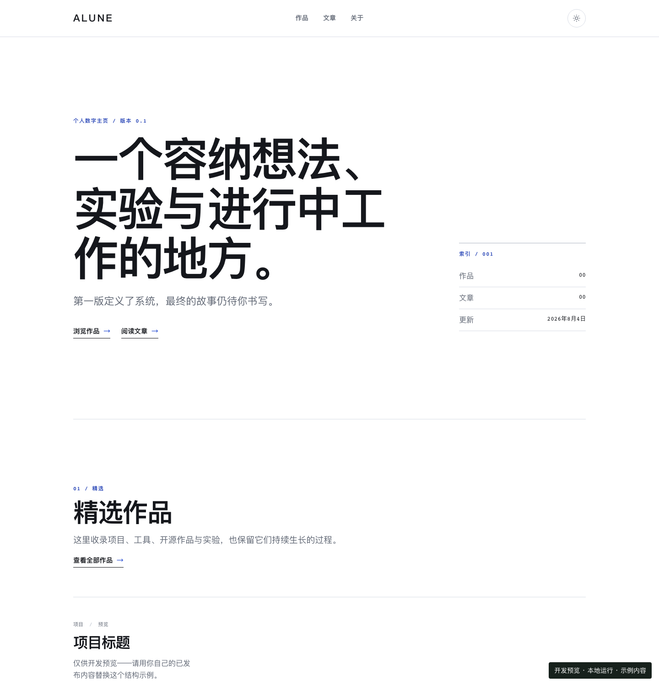

# alune

[](https://github.com/alune1212/alune/actions/workflows/ci.yml)

给 Alune 用的静态个人数字主页：作品、文章和个人介绍随这个仓库一起构建。

**状态：开发中，尚未正式发布。** 关于页已经写下名字来源；站点地址仍是占位域名，首页摘要和近况摘要仍是脚手架文案，作品与文章还没有已发布条目。

## 这个仓库是什么

alune 是单包 [Astro](https://astro.build/) 站点。页面在构建期生成 HTML、CSS 和必要的 JavaScript，放到任意静态文件服务器上即可。仓库里没有后端 API、数据库、登录、CMS 或部署 workflow。

主导航固定为 **作品**、**文章**、**关于**。近况和主题有独立页面，不进入这三项导航。

现在已经接上的能力：

- 作品（`studio`）、文章（`journal`）和固定页面（`pages`）使用严格 schema；公开标识来自文件路径，frontmatter 里不写 `slug`。
- 生产构建排除草稿。开发模式下，首页以及作品、文章列表为空时，会显示带“仅供开发预览”标记的结构示例，这些示例不会进入 `dist/`。
- 作品和文章列表每页 8 条。第 1 页就是栏目首页；只有多于一页时才生成 `/page/<n>/`，并显示分页。
- 主题索引、文章 RSS、sitemap，以及 canonical、Open Graph 和 JSON-LD。
- 亮色 / 暗色主题：默认跟随系统，也可以在页头手动切换。
- `placeholder` 为 `true` 时，页面带 `noindex, nofollow`，`/robots.txt` 为 `Disallow: /`。

## 技术栈

下表是当前默认分支 `package.json` 里的直接依赖。精确版本和锁文件解析结果以 [`package.json`](package.json) 与 [`pnpm-lock.yaml`](pnpm-lock.yaml) 为准；还没合入默认分支的依赖更新不会改变下表。

| 角色            | 包                                                              | 版本         |
| --------------- | --------------------------------------------------------------- | ------------ |
| 站点框架        | `astro`                                                         | 7.4.4        |
| MDX             | `@astrojs/mdx`                                                  | 8.1.2        |
| RSS             | `@astrojs/rss`                                                  | 4.0.19       |
| Sitemap         | `@astrojs/sitemap`                                              | 3.7.4        |
| 订阅源 Markdown | `markdown-it`                                                   | 15.0.3       |
| HTML 清洗       | `sanitize-html`                                                 | 2.18.1       |
| TypeScript      | `typescript`（`@typescript/typescript6`）、`@typescript/native` | 6.0.2、7.0.2 |
| 单元测试        | `vitest`                                                        | 5.0.5        |
| 浏览器测试      | `@playwright/test`                                              | 1.64.1       |
| Lint            | `eslint`                                                        | 10.14.0      |
| 格式            | `prettier`                                                      | 3.9.10       |

Node.js 以 [`.node-version`](.node-version) 为准，pnpm 以 `package.json` 的 `packageManager` 为准。`engines` 允许的范围是 Node `>=26.3.0 <27`、pnpm `>=11.20.0 <12`。TypeScript 7 与 6 的并存方式写在[开发与维护](docs/development.md)。

## 仓库结构

| 路径                              | 内容                                                                |
| --------------------------------- | ------------------------------------------------------------------- |
| `src/pages/`                      | 路由。页面文件决定公开 URL                                          |
| `src/content/studio/`             | 作品                                                                |
| `src/content/journal/`            | 文章                                                                |
| `src/content/pages/`              | 关于、近况的可选正文                                                |
| `src/content/_templates/`         | 写作模板，loader 不会发布                                           |
| `src/components/`、`src/layouts/` | 界面与页面骨架                                                      |
| `src/lib/`                        | schema、集合、分页、路由和结构化数据                                |
| `src/config/site.config.json`     | 可编辑的站点资料                                                    |
| `src/config/site.ts`              | 解析后的配置和主导航                                                |
| `src/styles/global.css`           | 颜色、字体、间距和亮色 / 暗色 token                                 |
| `src/scripts/theme-controller.ts` | 主题切换                                                            |
| `public/`                         | `favicon.svg` 与默认分享图 `og-default.svg`                         |
| `docs/`                           | 工程、内容、设计和路线图                                            |
| `tests/`                          | Vitest，以及当前站点 / 隔离内容两套 Playwright                      |
| `scripts/`                        | 文档检查、发布检查、隔离内容的临时构建                              |
| `astro.config.ts`                 | 静态输出、末尾斜杠、MDX、sitemap、代码高亮                          |
| `.github/`                        | 议题与 PR 模板、Dependabot、质量检查、PR 标题、CodeQL。没有部署 job |

`pnpm-workspace.yaml` 没有子包。它只保存 pnpm 的依赖构建许可和版本覆盖。

## 公开路径

| 路径                                | 用途                                                  |
| ----------------------------------- | ----------------------------------------------------- |
| `/`                                 | 首页：定位、最多 3 条精选作品、3 篇最新文章、近况摘要 |
| `/studio/`、`/studio/page/<n>/`     | 作品列表与分页                                        |
| `/studio/<entry-id>/`               | 作品详情；entry ID 可以包含嵌套路径                   |
| `/journal/`、`/journal/page/<n>/`   | 文章列表与分页                                        |
| `/journal/<entry-id>/`              | 文章详情；entry ID 可以包含嵌套路径                   |
| `/about/`                           | 关于页。当前正文是名字来源的故事                      |
| `/now/`                             | 近况页                                                |
| `/topics/`、`/topics/<topic>/`      | 跨作品和文章的主题索引                                |
| `/rss.xml`                          | 文章 RSS。正文经过 Markdown 渲染和 HTML 清洗          |
| `/robots.txt`、`/sitemap-index.xml` | 爬虫策略和 sitemap。占位阶段禁止整站抓取              |
| `/404.html`                         | 静态未找到页面，始终 `noindex`                        |

首页在有 `featured` 作品时只展示这些精选，否则展示排序后的前 3 条。近况区块始终读取配置里的 `now.summary` 和 `now.updatedAt`。订阅源和索引的细节见[开发与维护](docs/development.md)。

## 快速开始

需要 Git、Node.js 和 pnpm。用 `git --version`、`node --version` 和 `pnpm --version` 确认三者可用，并把 Node.js、pnpm 切到上一节所说的版本。

```bash
git clone https://github.com/alune1212/alune.git
cd alune
pnpm install --frozen-lockfile
pnpm dev
```

开发地址默认是 `http://localhost:4321/`。端口被占用时，以终端输出为准。

```bash
pnpm build
pnpm preview
```

`pnpm preview` 查看 `dist/` 的静态结果，默认同样是 `http://localhost:4321/`。

### 开发预览

下图来自本地开发模式，含结构示例和尚待替换的文案，截图内已标注“开发预览”。当前生产构建里的作品与文章仍为空。



## 质量检查

| 命令                 | 作用                                                                    |
| -------------------- | ----------------------------------------------------------------------- |
| `pnpm lint`          | ESLint，警告也算失败                                                    |
| `pnpm format`        | 用 Prettier 写回格式                                                    |
| `pnpm format:check`  | 只检查格式                                                              |
| `pnpm typecheck`     | `astro check`                                                           |
| `pnpm test`          | `tests/unit/` 下的 Vitest                                               |
| `pnpm test:watch`    | Vitest 监听模式                                                         |
| `pnpm docs:check`    | 文档链接、索引、脚本名和主导航是否与仓库一致                            |
| `pnpm check`         | 文档、lint、格式、类型、单元测试和构建                                  |
| `pnpm e2e`           | 先构建，再跑当前站点与隔离内容两套浏览器测试                            |
| `pnpm e2e:preview`   | 用已有 `dist/` 跑当前站点的桌面端和移动端测试                           |
| `pnpm e2e:content`   | 在系统临时目录注入 fixture 后测试分页、嵌套详情、关联、主题、RSS 和样式 |
| `pnpm e2e:ci`        | 顺序运行 `e2e:preview` 与 `e2e:content`；不重复构建当前站点             |
| `pnpm e2e:list`      | 列出两套 Playwright 用例                                                |
| `pnpm check:release` | 先检查正式发布资料和最低内容，再运行 `pnpm check`                       |

第一次跑浏览器测试前：

```bash
pnpm exec playwright install chromium
```

`pnpm e2e` 覆盖桌面端 Chromium 和移动端 Chromium。隔离套件不会改仓库里的正式内容。当前占位阶段运行 `pnpm check:release` 会失败，这是发布保护，不是安装故障。

## 写作

1. 从 `src/content/_templates/` 复制对应模板到 `studio/`、`journal/` 或 `pages/`。
2. 用相对路径当 entry ID。例如 `journal/notes/first.md` 的地址是 `/journal/notes/first/`。
3. 保持 `draft: true`，直到标题、摘要、日期和外链都可以公开。生产构建会丢掉草稿。
4. `relatedJournal` 和 `relatedStudio` 填对方的 entry ID。字段、排序和固定页面的回退规则见[内容指南](docs/content-guide.md)。

准备正式上线时再运行 `pnpm check:release`。它要求关掉占位、换上真实 HTTPS 源站、备齐作者联系信息，并且作品和文章各至少有一条非草稿内容。

## 配置

可编辑的站点资料在 `src/config/site.config.json`，由 `src/config/site-schema.ts` 校验：

| 字段                           | 当前约定                                                            |
| ------------------------------ | ------------------------------------------------------------------- |
| `placeholder`                  | 现为 `true`。为真时全站 `noindex`，且 robots 禁止抓取               |
| `siteUrl`                      | 必须是不带路径、查询或片段的 HTTPS 源站。现为 `https://example.com` |
| `name`、`title`、`description` | 站点名、标题和简介                                                  |
| `locale`                       | 固定为 `zh-CN`                                                      |
| `author.name`、`author.email`  | 作者名和邮箱                                                        |
| `hero`                         | 首页眉题、标题和摘要                                                |
| `about.lead`、`about.body`     | 没有已发布关于页时的回退文案                                        |
| `now.updatedAt`、`now.summary` | 首页近况日期和摘要。`/now/` 有正文时，正文只替换近况页              |
| `socials`                      | `{ label, href }` 列表，`href` 必须是 HTTPS。现为空数组             |

`astro.config.ts` 把 `site` 设为上面的 `siteUrl`，输出模式为 `static`，`trailingSlash` 为 `always`，并启用 MDX、sitemap，以及 `github-light` / `github-dark` 代码高亮。主导航的名称和顺序写在 `src/config/site.ts`。

## 持续集成与部署

持续集成、拉取请求标题、CodeQL、Dependabot 分组和合并规则写在[开发与维护](docs/development.md)的「协作流程」。`.github/workflows/ci.yml` 只有 `contents: read`。`check:release` 不在 CI 里。仓库没有部署步骤。

部署仍未决定。域名、托管、缓存、回滚和中国大陆三网直连的验收方式写在[路线图](docs/roadmap.md) 的部署决策门；这些决定完成之前，仓库不添加 deployment workflow。

## 文档

- [开发与维护](docs/development.md)：数据流、协作流程、RSS 清洗、质量门和发布检查。
- [参与协作](CONTRIBUTING.md)：分支、提交钩子、拉取请求和合并前要跑的命令。
- [内容指南](docs/content-guide.md)：集合、entry ID、frontmatter 和模板。
- [设计方向](docs/design-direction.md)：视觉、主题、排版和无障碍。
- [路线图](docs/roadmap.md)：当前阶段和明确不做什么。
- [协作规范](AGENTS.md)：仓库内 agent 的实施和验证要求。

## 协作与许可

改动页面、交互、路由或样式时，提交前运行 `pnpm check` 和 `pnpm e2e`。只改文档或纯逻辑时，`pnpm check` 是仓库要求的门禁。分支命名、提交钩子和拉取请求标题见[参与协作](CONTRIBUTING.md)。构建产物、测试报告、环境文件和编辑器缓存不要提交。

代码使用 [LICENSE](LICENSE) 中基于 MIT 文本修改的许可。该文件限定代码范围，并排除内容与品牌素材；以全文为准。`package.json` 用 `SEE LICENSE IN LICENSE` 指向它。原创文章、品牌名称、视觉识别和其他品牌素材见 [CONTENT_LICENSE.md](CONTENT_LICENSE.md)。
