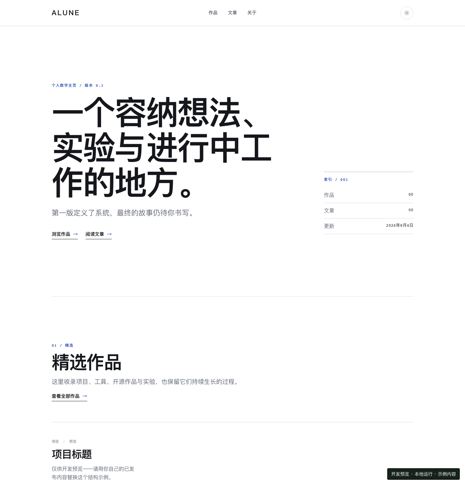

# alune

alune 是一个使用 Astro 构建的个人数字主页，用来长期沉淀作品、文章和个人介绍。站点保持静态优先：内容随仓库构建，不依赖后端、数据库或 CMS。

**状态：开发中，尚未正式发布。** 当前工程基础已经完成，关于页已有名字来源的故事；站点仍使用占位域名及部分首页、近况文案，作品与文章尚待补充。

## 开始使用

先准备 Git、Node.js 和 pnpm。Node.js 版本以 [`.node-version`](.node-version) 为准，pnpm 版本以 [`package.json`](package.json) 的 `packageManager` 为准；可以使用已有的版本管理器切换到相应版本。用 `git --version`、`node --version` 和 `pnpm --version` 确认工具可用后：

```bash
git clone https://github.com/alune1212/alune.git
cd alune
pnpm install --frozen-lockfile
pnpm dev
```

开发地址为 `http://localhost:4321/`；若端口被占用，以终端实际输出为准。开发模式会在作品与文章为空时显示带“仅供开发预览”标记的结构示例，它们不会进入生产构建。

构建和本地预览：

```bash
pnpm build
pnpm preview
```

预览地址同样默认为 `http://localhost:4321/`，用于检查 `dist/` 的实际静态输出。

常用质量命令：

```bash
pnpm docs:check    # 检查文档链接、索引和工程事实
pnpm check         # 文档、代码、格式、类型、单元测试和构建
pnpm e2e           # 当前空内容站点与隔离已发布内容站点的桌面端、移动端测试
pnpm check:release # 质量门加正式发布条件
```

首次运行浏览器测试前，需要安装 Chromium：

```bash
pnpm exec playwright install chromium
```

`check:release` 当前会因占位站点资料及缺少正式作品（`studio`）、文章（`journal`）内容而失败，这是预期的发布保护，而不是工程故障。

`pnpm e2e` 会先构建当前仓库站点，再运行基础 E2E 和隔离的完整内容 E2E。隔离套件在系统临时目录中注入非占位 fixture，覆盖分页、嵌套详情、关联、主题、RSS、正文样式和无障碍，不会修改正式内容目录。

## 开发预览

下图来自本地开发模式，包含开发用结构示例及尚待完善的文案，截图内已标注“开发预览”。当前生产构建中的作品与文章仍为空。



## 公开结构

主导航固定为 **作品**、**文章**、**关于**。

| 路径                                | 用途                                |
| ----------------------------------- | ----------------------------------- |
| `/`                                 | 首页、精选内容和近期状态            |
| `/studio/`、`/studio/page/<n>/`     | 作品列表与分页                      |
| `/studio/<entry-id>/`               | 作品详情；entry ID 可以包含嵌套路径 |
| `/journal/`、`/journal/page/<n>/`   | 文章列表与分页                      |
| `/journal/<entry-id>/`              | 文章详情；entry ID 可以包含嵌套路径 |
| `/about/`                           | 关于页，目前介绍名字来源的故事      |
| `/now/`                             | 近况页、当前关注与近期状态          |
| `/topics/`、`/topics/<topic>/`      | 跨作品、文章的主题索引              |
| `/rss.xml`                          | 文章 RSS 订阅源                     |
| `/robots.txt`、`/sitemap-index.xml` | 搜索引擎入口                        |
| `/404.html`                         | 静态未找到页面                      |

## 文档

- [开发与维护](docs/development.md)：技术边界、数据流、质量门和发布检查。
- [内容指南](docs/content-guide.md)：内容集合、entry ID、frontmatter 和模板约定。
- [设计方向](docs/design-direction.md)：视觉、排版、响应式与无障碍原则。
- [路线图](docs/roadmap.md)：当前状态、下一阶段和扩展决策门。
- [协作规范](AGENTS.md)：仓库内 agent 的实施和验证要求。

## 许可证

代码使用 [LICENSE](LICENSE) 中基于 MIT 文本修改的许可，其中明确限定了代码范围并排除内容与品牌素材；应以该文件的完整条款为准。`package.json` 使用 `SEE LICENSE IN LICENSE` 指向这份文本。原创文章、品牌名称、视觉识别和其他品牌素材的许可范围见 [CONTENT_LICENSE.md](CONTENT_LICENSE.md)。
